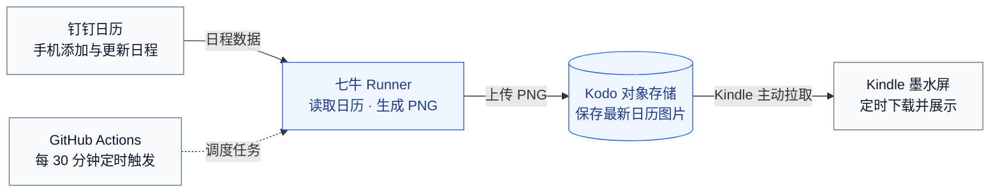

# 家庭日历技术方案：七牛 Runner + Kodo

状态：Kodo 发布、签名工具、Kindle 轮询与手动演示工作流已实现；钉钉、自动天气查询及真实云端/设备联调未完成。本文描述目标完整架构，实际状态以 [README.md](README.md#当前状态) 为入口。

## 目标与范围

家庭成员通过已有日历产品维护安排，项目只负责读取、排版、发布和设备展示。无需购买云主机，无需维护常驻 Web 服务和业务数据库。Runner / Sandbox 与 Kodo 资源费用按项目规模视为基本可忽略，不将其描述为永久免费。

首版选择一个钉钉共享日历、一台 Kindle PW3；飞书通过后续适配器接入。无需为演示额外加入 AI 或重做手机管理端。业务背景和价值见 [PRODUCT.md](PRODUCT.md)，显示规范见 [DESIGN.md](DESIGN.md)。

## 架构与职责



日历产品负责编辑，GitHub 负责调度，七牛 Runner 按需生成图片，Kodo 持久保存，Kindle 独立拉取展示。首版先接钉钉；生成与下载失败时保留上一张成功图片。

| 组件 | 职责 | 持久化内容 |
| --- | --- | --- |
| 钉钉日历 | 手机编辑、共享权限、日程保存 | 原始日程，作为唯一数据源 |
| GitHub | 保存代码和工作流，定时调度，管理任务密钥 | 代码、任务状态和脱敏日志 |
| 七牛 Runner | 为 Job 创建沙箱，执行 Python 批处理，结束后清理 | 不依赖沙箱本地文件跨任务保存 |
| Kodo | 保存已发布图片，供设备独立下载 | 当前图片和有限历史版本 |
| Kindle | 下载、验证、显示，失败保留上一张图 | 最近一次成功显示的 PNG 和设备配置 |

采用七牛托管 Runner 平台，不自行部署 runnerd。仓库需安装平台 GitHub App，并在 Repositories 确认 Runner readiness、有效 Sandbox 来源和 Runner 规格。

2026-10-24 文档核实时，线上公开模板接口提供 `[qiniu, ubuntu-24.04]` 标签；具体仓库能否使用仍以平台准入和 readiness 为准。无需在个人电脑保持 Runner 在线。

钉钉共享日历需先验证家庭成员能在手机中编辑，以及调用身份能读取实际标题和详情。首版优先验证企业内部应用接入，按所选日历接口确认使用应用令牌还是用户授权令牌，以及是否要求操作者 unionId；不能假定应用密钥足以读取所有个人日历。成员不在同一组织时不能默认具备共享权限，先用专用演示日历完成验证，再确认家庭实际共享方式。具体权限、令牌及重复实例接口在实施时按钉钉官方文档核实。

## 一次任务的处理流程

1. 按工作流配置的 `TIMEZONE`（默认 `Asia/Shanghai`）确定当前日期、月历完整网格范围及未来近期安排范围。日历与天气使用同一时区，避免“今天”不一致。
2. 从 Secrets 获取钉钉应用凭据，按已验证的身份与授权流程取得访问令牌，读取指定共享日历；接口要求时传入操作者身份。仅申请读取所需权限，并验证实际能读到活动标题和详情。若接口要求用户授权，应先验证授权与续期方式，再接入定时任务。
3. 完整拉取所需活动，处理分页、取消和删除状态。首版每次读取完整展示窗口，不维护增量同步游标。
4. 统一转换为渲染数据：来源 ID、标题、开始、结束、全天标记和成员文字。按时区和真实日期排序，正确处理排他结束日期、跨天事件和重复实例的单次修改 / 取消。全天活动按覆盖日期展示；跨天定时活动拆分为覆盖日期的显示项，进行中的活动仍纳入近期安排。现有 renderer 仅支持 `day/time/title/member`，需由适配层或渲染改造承接这些语义，不丢弃结束时间后直接套用。普通日程列表可能只返回重复规则，需验证实例接口或明确实现规则展开。
5. 解析 GitHub Actions 的天气地区配置：完整有效的经纬度优先；未填、只填一项或坐标非法时，均回退到城市名称查询坐标，再获取今天起三天的天气。图片展示配置或查询得到的地区名称。网络错误时显示“天气暂不可用”，不阻断日历发布；首版不依赖跨任务的本地天气缓存。
6. 复用 Pillow 渲染，输出 1072 × 1448、16 级灰度 PNG，使用固定中文字体。校验尺寸、格式、灰度与文件大小。
7. 上传不可变版本，确认成功后，再覆盖设备读取的 `latest.png`。任何读取不完整、渲染或发布错误都不主动删除上一版。
8. 日志仅记录活动数量、生成时间、对象 key、耗时和错误类别，不记录日程正文、令牌或签名 URL。

钉钉返回空列表且查询完整成功时，允许发布空日历，以正确体现“全部删除”；接口失败、分页未完成或解析错误不能当作空列表。

## 调度与刷新

当前 [`.github/workflows/calendar.yml`](.github/workflows/calendar.yml) 只开放手动演示：显式确认空日历，限制 `demo-` 屏幕，完成渲染、上传和读回。已固定 Action 提交、Python/Pillow/HTTP 依赖并安装中文字体。真实来源未接入前，不开启周期性空日历发布。

以下是接入真实来源后的生产调度目标，省略 `steps`，不能直接作为完整工作流运行：

```yaml
name: 发布家庭日历

on:
  schedule:
    - cron: "7,37 * * * *"
  workflow_dispatch:

permissions:
  contents: read

concurrency:
  group: family-calendar-publish
  cancel-in-progress: false

jobs:
  publish:
    runs-on: [qiniu, ubuntu-24.04]
    timeout-minutes: 10
    env:
      WEATHER_CITY: ${{ vars.WEATHER_CITY }}
      WEATHER_LATITUDE: ${{ vars.WEATHER_LATITUDE }}
      WEATHER_LONGITUDE: ${{ vars.WEATHER_LONGITUDE }}
      TIMEZONE: ${{ vars.TIMEZONE || 'Asia/Shanghai' }}
```

生产启用前补齐真实来源读取与自动天气步骤，验证接口失败不会被当作空日历。首次先手动触发成功，再启用定时；演示工作流成功仅证明演示图片链路。

- 默认每小时第 7、37 分钟生成图片，每天计划 48 次。cron 使用默认 UTC；默认北京时间对应的分钟相同，图片日期按配置的 `TIMEZONE` 计算。
- 定时工作流必须位于默认分支，只运行默认分支版本，不依赖代码变更。GitHub 最短调度间隔为 5 分钟。
- GitHub 高负载时可能延迟或丢弃部分排队任务，不提供准点保证。公开仓库连续 60 天无活动会停用定时任务，家庭项目使用私有仓库。
- 用单一工作流和固定 concurrency group 串行发布；GitHub 默认只保留一个待运行任务，新任务可替换待运行任务，不保证按触发顺序逐次执行。每次实际开始执行后重新读取最新日历，不发布旧任务预先生成的图片，不将工作流触发时间当作图片生成时间。
- API 请求设置超时，对限流和暂时错误有限重试；整个任务最多 10 分钟，终止或超时不得主动删除已发布图片。
- Kindle 默认每 30 分钟下载一次。两轮询叠加，修改到显示在正常条件下可能接近 60 分钟，另加调度、执行与缓存延迟；“每 30 分钟生成”不等于“30 分钟内一定看到”。
- 即使没有日程变更，也按计划刷新日期、今天高亮和天气；默认北京时间跨天后第一个计划任务约在 00:07，存在正常的跨天延迟。
- 比赛现场手动触发工作流，完成后在设备执行一次下载，不等待日常周期。不为演示另建常驻回调服务。

## 天气地区配置

天气地区在仓库 **Settings → Secrets and variables → Actions → Variables** 中维护，由工作流通过环境变量传入批处理，不写死在天气服务或 Kindle 脚本中。地区不是敏感信息，无需使用 Secrets。

| Actions Variable | 示例 | 含义 |
| --- | --- | --- |
| `WEATHER_CITY` | `上海` | 无完整有效坐标时用于城市查询；有完整有效坐标时仅作显示名称，可留空 |
| `WEATHER_LATITUDE` | `31.2304` | 可选纬度，范围 -90 至 90，需与经度一起填写 |
| `WEATHER_LONGITUDE` | `121.4737` | 可选经度，范围 -180 至 180，需与纬度一起填写 |
| `TIMEZONE` | `Asia/Shanghai` | 日历与天气共用的 IANA 时区，默认北京时间 |

最简配置只填 `WEATHER_CITY=上海`，两项坐标留空；需要精确定位时再补充完整坐标。上海仅为示例，不是缺省地区。

地区解析规则如下，下一次任务生效：

| 配置情况 | 行为 |
| --- | --- |
| 经纬度均已填写且有效 | 直接按坐标查询天气，不调用城市查询；城市名仅用作标题，未填时显示“当地天气” |
| 经纬度均未填写，城市名已填写 | 使用 Open-Meteo Geocoding API 查询城市，解析坐标后请求天气 |
| 经纬度均未填写，城市名也未填写 | 天气不可用，日志提示配置城市或完整坐标 |
| 只填一项坐标，或任意坐标非法 | 记录坐标配置提示，回退到城市查询；城市名为空时天气不可用 |
| 城市查询超时、无结果或结果无法唯一确定 | 天气不可用，日志提示重试、补充城市所属国家 / 省份或直接填写坐标 |

未填写的判断采用去除首尾空白后的空字符串，数值 `0` 是有效坐标，不能当作缺失。坐标必须是有限数值并在合法范围内。仅当经纬度完整且均有效时才使用整组坐标，否则整组放弃并查询城市，不混用手填坐标与城市解析坐标。坐标优先时城市名不得改变查询位置；清空坐标可主动改用城市查询。

城市查询使用 `https://geocoding-api.open-meteo.com/v1/search`，通过请求参数传递 `name`、`language=zh` 和多个候选结果。先匹配规范化城市名及可选的国家 / 省份限定，唯一匹配后才继续，不盲取首个同名城市。请求设置超时，对暂时错误有限重试；最终失败只降级天气，不影响日历发布。图片保留 Open-Meteo 来源网址，配置与运行文档补充地理编码数据的 GeoNames 来源说明；API 适用范围以供应商条款为准。

`TIMEZONE` 始终由工作流配置决定，默认 `Asia/Shanghai`，不会被城市查询返回的时区静默覆盖。跨时区使用时应主动修改它；非法时区会影响日历日期，应终止发布并保留旧图。未来若持久化天气缓存，缓存标识必须包含最终解析的经纬度和时区；城市查询缓存另按城市查询词标识，避免更换地区后复用旧预报。

## Kodo 发布与下载

模块接口、图片元数据、发布失败恢复、设备轮询与验收用例见 [Kodo 图片发布与 Kindle 定时拉取详细设计](docs/superpowers/specs/2026-10-25-kodo-kindle-delivery-design.md)。发布与设备代码已实现，本地验证及外部待验收项见 [实施计划](docs/superpowers/plans/2026-10-25-kodo-kindle-delivery.md)。

`publication.py` 管理发布状态机，`storage/kodo.py` 使用官方 SDK 签名和 ETag 算法。`KODO_UPLOAD_HOST` 明确指定 Bucket 所属区域的 HTTPS 上传入口；每次 HTTP 请求由独立子进程执行，关闭重定向、保持 TLS 校验，父进程限制下载 30 秒/上传 60 秒并服从共享总截止时间。Job 最多 10 分钟，内部最多 9 分钟且预留恢复时间；重试不重置预算。

建议一个专用私有 Bucket，使用标准存储和可长期使用、证书受信任的 HTTPS 访问域名。30 天测试域名仅用于联调，不作为长期地址。

对象布局示意：

```text
family-calendar/<screen-id>/latest.png
family-calendar/<screen-id>/history/2026-10-24/<run-id>-<attempt>.png
```

`latest.png` 是设备固定入口，含义为最近一次成功生成的日历；正常运行时即当天日历。历史图用于验证与回滚，建议生命周期保留 7 天。图片生成时间体现在顶部“更新于 HH:mm”，运行失败时旧图可能跨天，不能宣称一定为当天。

首版不让 Kindle 拼接日期访问历史图，以避免日期路径、签名和跨天失败处理的复杂度。生成任务先上传历史版本，再完整覆盖 `latest.png`；历史 key 包含工作流 run-id 和重跑 attempt，避免覆盖上次尝试。覆盖上传策略需明确允许更新固定 key。历史上传成功但 latest 更新失败时，设备继续读取上一版，下次任务重试。历史和 latest 两次写入不是跨对象事务，不承诺两者同时成功。

设备链路优先采用专用 HTTPS 源站域名。若接 CDN，需为 `latest.png` 配置不缓存或短缓存（目标不超过 60 秒）并实测覆盖后的可见性；历史版本可长缓存。不靠给已签名 URL 随意追加时间戳规避缓存，改变 URL 参数需要重新签名。

生成时在 PNG 非可见元数据中记录 UTC `generated_at`、run-id 与 attempt，显示时间仍按配置时区渲染为 HH:mm。发布前读取并暂存上一版 latest 的字节及生成标识，校验待发布版本不会比已发布版本更旧；不为这些信息新增数据库或常驻服务。首次读取返回 404 视为尚无旧版，其他读取错误应终止发布。

发布后通过固定下载入口验证响应、图片尺寸和内容摘要。若覆盖结果不确定或读回失败，任务记为失败；存在上一成功版本时按单一发布者约束恢复，并再次验证。首次发布没有旧版时明确报告无可恢复版本，不假装回滚成功。上传和读回成功只证明图片已发布，不证明 Kindle 已下载或显示；设备显示单独验收。设备不解析新增的 PNG 元数据，仍按普通 PNG 显示。

## 凭据与设备鉴权

| 配置 | 存放位置 | 用途 |
| --- | --- | --- |
| `DINGTALK_APP_KEY` / `DINGTALK_APP_SECRET` | GitHub Secrets | 钉钉应用凭据，按所选接口完成令牌获取；实际权限需联调验证 |
| `DINGTALK_CALENDAR_ID` | 仓库 Variables | 指定家庭共享日历 |
| `DINGTALK_OPERATOR_UNION_ID` | GitHub Secrets，按接口需要配置 | 指定日历读取操作者，不与日历 ID 或组织内 userId 混用 |
| `QINIU_ACCESS_KEY` / `QINIU_SECRET_KEY` | GitHub Secrets | 专用发布身份，限定 Bucket / 前缀的上传、读回校验和必要恢复权限 |
| `KODO_BUCKET` / `KODO_DOMAIN` / `SCREEN_ID` | 仓库 Variables | 发布目标与稳定设备标识，域名使用完整 HTTPS 地址 |
| `KODO_UPLOAD_HOST` | 仓库 Variables | Bucket 区域对应的 HTTPS 上传入口，不通过 SDK 自动发现 |
| 天气地区名称、经纬度、TIMEZONE | 仓库 Actions Variables，经工作流 env 传入 | 控制天气查询位置、地区标题和日期时区 |
| `latest.png` 私有签名下载 URL 及到期日 | Kindle 本地受限配置 / 维护记录 | 只读取固定图片，不下发上传密钥 |
| 受信任 CA 与 FBInk 路径 | Kindle 本地配置 | HTTPS 校验和绘屏 |

首版采用配置时生成的固定对象签名 URL，建议有效期 30 天，截止前手动重新生成并更新设备配置。凭证允许在有效期内反复获取同一个 key 的新内容。此方案没有自动续期能力，是首版明确的维护项；有效期和最长允许期限需在所用下载链路实测。

Kindle 使用所选 HTTPS 域名的可信 CA 链，设备系统时间须正确。发布者私有下载签名及最小权限组合必须先验证，不能假定“仅有上传权限”足以完成读回和恢复。Python 天气 / Kodo SDK、中文字体及 TLS 版本在 Runner 环境中单独确认。

签名 URL 是访问凭据，通过可信通道配置到设备，文件权限设为仅设备用户可读；通过 curl 配置文件传入，不输出到日志或作为工作流公开产物。泄露后需撤销对应授权或更换对象入口及签发密钥，不能假设签名 URL 有独立的一键撤销接口。设备不保存钉钉凭据或 Kodo AK / SK。

设备下载按 Kodo 官方签名 URL 协议实现，通过 curl 配置文件传入完整地址；日志不得回显签名查询参数或完整请求地址。

真实家庭内容不使用公开 Bucket。比赛演示使用经同意的演示活动，不在代码仓库和任务附件中保存真实家庭日程。首版不上传包含私人内容的测试截图或 PNG 到 GitHub Artifacts。

## 改造清单

以下列出已有基础与待实施模块，已有脚本不等于完整链路可用：

| 模块 | 状态与工作内容 |
| --- | --- |
| `preview.py` | 已实现：离线 PNG、发布元数据、`--screen-id`；同一生成时间用于画面及元数据 |
| `calendar_sources/dingtalk.py` | 待新增：钉钉只读接入、身份与授权、分页、日期与重复实例规范化 |
| `publication.py` | 已实现：PNG/元数据校验、版本冲突检查、历史/固定入口发布、幂等及失败恢复 |
| `scripts/publish_calendar.py` | 已实现：发布现成 PNG，输出脱敏 JSON 和明确退出码 |
| `scripts/sign_download_url.py` | 已实现：签名写入新建 0600 文件，不输出完整 URL |
| `storage/kodo.py` / `storage/http_worker.py` | 已实现：官方签名、上传响应校验、有限重试、HTTPS 读回与请求硬超时 |
| `.github/workflows/calendar.yml` | 已实现手动演示、Runner 标签、Secrets 和串行发布；生产 schedule 待来源接入 |
| `renderer.py` | 已有基础排版；待适配外部日历的全天、跨天及进行中活动 |
| `weather.py` | 已有纯数据解析；待新增地区配置、坐标优先、城市查询回退和预报请求 |
| `kindle/run.sh` / `kindle/common.sh` | 已实现循环/单次下载、缓存重绘、图片头校验、锁、状态、日志和退出恢复 |
| `kindle/control.sh` | 已实现 start/status/stop，校验 PID、启动标识和脚本路径 |
| `kindle/config.example.sh` | 已提供签名 URL、到期日、CA bundle、FBInk 和下载周期配置示例 |
| 运行依赖 | 固定 Pillow、qiniu、requests 及 HTTP 传递依赖；当前验证环境 Python 3.12.15 |

线上入口是执行后退出的 Python 批处理，日程以外部日历为唯一数据源，图片持久化到 Kodo。发布层只接收校验通过的 PNG；来源适配在渲染之前完成，后续飞书适配可沿用相同图片发布接口。本地直接通过 Python 运行脚本，不要求部署常驻服务。

## 验收与实施顺序

1. **依赖验证**：用一个演示日历读取活动；手动工作流在七牛 Runner 成功执行；Kodo 私有 HTTPS 图片能被 Kindle 实际下载、显示。并行于开发尽早完成设备运行环境检查。
2. **云端闭环**：实现单次批处理，验证新增、修改、删除和空日历；重复、全天、跨天、月末及跨年事件须符合来源语义。
3. **可靠发布**：验证分页失败不发布空图、天气失败仍可生成、覆盖更新可见、签名过期不替换旧图、旧版本拒绝覆盖、任务中断及重跑后的恢复。天气覆盖有效坐标优先、零值坐标、仅城市、无配置、单项 / 非法坐标回退、同名城市和地理编码失败。
4. **实机试运行**：观察 48–72 小时，覆盖午夜切换、网络中断和恢复。设备需要 Wi-Fi，首版 USB 供电，不承诺深度休眠续航。
5. **展示交付**：现场完成“手机修改 → 手动触发 → 七牛任务完成 → Kodo 新图片 → Kindle 新画面”，并保留运行失败时的说明和已成功生成的备用演示图。

关键依赖是：共享日历的应用读取权限、仓库的 Runner 使用权限、Kodo 长期 HTTPS 域名，以及 PW3 的脚本 / TLS / FBInk 环境。实现阶段按这四项分别验证，不将云端上传成功等同于实机交付完成。

## 官方依据

- [七牛 Runner 官方项目及运行原理](https://github.com/qiniu/ci-runner)：按 Job 创建临时 Sandbox，结束后清理。
- [七牛托管版接入指南](https://runner.qiniuinc.com/docs/getting-started/hosted)。
- [线上公开 Runner 模板](https://runner.qiniuinc.com/api/public/runner-templates)：已核实包含 `qiniu + ubuntu-24.04`。
- [GitHub schedule](https://docs.github.com/en/actions/reference/workflows-and-actions/events-that-trigger-workflows#schedule)：默认分支、调度间隔、延迟及公开仓库停用规则。
- [GitHub concurrency](https://docs.github.com/en/actions/how-tos/write-workflows/choose-when-workflows-run/control-workflow-concurrency)：串行运行、待运行任务替换与执行顺序。
- [钉钉开放平台](https://open.dingtalk.com/orgapp)：日历与日程能力入口；具体读取接口、权限、分页和重复实例规则在接入时核实。
- [钉钉企业内部应用令牌](https://open.dingtalk.com/document/orgapp/obtain-the-access_token-of-an-internal-app)：应用令牌接入入口，是否适用于目标日历须结合具体接口验证。
- [Kodo 下载凭证](https://developer.qiniu.com/kodo/1202/download-token)：私有资源签名 URL 和到期校验。
- [Kodo 上传策略](https://developer.qiniu.com/kodo/manual/put-policy)：固定 key 的覆盖和新增语义。
- [Open-Meteo 城市查询](https://open-meteo.com/en/docs/geocoding-api)：按城市名查询坐标、国家 / 行政区域限定和 GeoNames 来源。
- [七牛测试域名规范](https://developer.qiniu.com/fusion/kb/1319/test-domain-access-restriction-rules)：测试域名生命周期 30 天。
