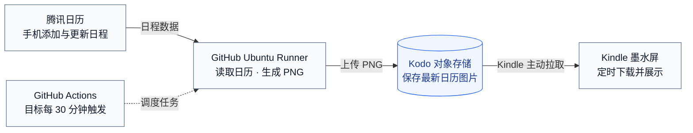

# 家庭日历技术方案：GitHub Actions + Kodo

状态：CalDAV、天气、Kodo 不可变图片发布、Kindle list 选择与轮询、手动演示工作流已有代码；Kindle 真实 list 和授权 HTTP 下载 / 绘屏与连续两轮 5 分钟更新已通过，HTTPS 图片、Runner 与长期轮询待验收。本文描述目标完整架构，实际状态以 [README.md](README.md#当前状态) 为入口。

## 目标与范围

家庭成员通过已有日历产品维护安排，项目只负责读取、排版、发布和设备展示。无需购买云主机，无需维护常驻 Web 服务和业务数据库。执行费用受 GitHub Actions 额度和 Kodo 计费影响，不将其描述为永久免费。

首版选择腾讯日历（CalDAV）、一台 Kindle PW3；飞书通过后续适配器接入。无需为演示额外加入 AI 或重做手机管理端。业务背景和价值见 [PRODUCT.md](PRODUCT.md)，显示规范见 [DESIGN.md](DESIGN.md)。

## 架构与职责



日历产品负责编辑，GitHub 负责调度并提供 Ubuntu Runner 按需生成图片，Kodo 持久保存，Kindle 独立拉取展示。首版先接腾讯日历 CalDAV；生成与下载失败时保留上一张成功图片。

| 组件 | 职责 | 持久化内容 |
| --- | --- | --- |
| 腾讯日历 | 手机编辑、共享权限、日程保存 | 原始日程，作为唯一数据源 |
| GitHub | 保存代码和工作流，定时调度，管理任务密钥 | 代码、任务状态和脱敏日志 |
| GitHub 托管 Runner | 为 Job 分配 Ubuntu 环境，执行 Python 批处理，结束后清理 | 不依赖执行环境本地文件跨任务保存 |
| Kodo | 保存已发布图片，供设备独立下载 | 不可变时间戳图片，建议配置 7 天生命周期 |
| Kindle | 下载、验证、显示，失败保留上一张图 | 最近一次成功显示的 PNG 和设备配置 |

发布和回归工作流均采用 GitHub 托管的 `ubuntu-24.04`，由 GitHub 按任务分配临时环境。

GitHub Free 组织的私有仓库共享每月 2,000 分钟标准 Runner 额度；调度频率、任务耗时和其他工作流共同消耗额度，实际可用量以组织账单页面为准。

腾讯日历使用 HTTPS CalDAV 地址、账号及专用密码接入，不依赖企业应用或 OAuth 权限。2026-10-25 已在本机验证 CalDAV 发现、逐条读取与渲染，并用于每 5 分钟生成任务；日程数量随来源变化，不作为固定配置。默认合并全部可发现日历，可通过 `CALDAV_CALENDAR_NAME` 指定唯一名称；账号下可见不代表家庭成员均可编辑，成员共享、增删改传播和服务端重复例外仍需单独验收。

## 一次任务的处理流程

1. 按工作流配置的 `TIMEZONE`（默认 `Asia/Shanghai`）确定当前日期、月历完整网格范围及未来近期安排范围。日历与天气使用同一时区，避免“今天”不一致。
2. 从 Secrets 获取 CalDAV 服务地址、账号与专用密码，通过 HTTPS 发现并读取日历；可指定唯一日历名称。请求超时 15 秒，当前本地入口失败后重新执行；云端入口需补充有限重试和任务超时。
3. 完整拉取所需活动，处理分页、取消和删除状态。首版每次读取完整展示窗口，不维护增量同步游标。
4. `calendar_source.py` 通过 python-caldav 发现记录地址，逐条 GET 读取完整数据，再通过 recurring-ical-events 展开重复日程及单次例外，跳过取消项，保留来源 ID、开始、结束和全天标记，转换为渲染数据。全天结束日期排他，跨天事项拆分为覆盖日期的显示项，进行中事项保留到结束，近期安排按实例去重。浮动时间使用配置时区；旧 JSON 输入仍支持 `day/time/title/member`，未提供结束时间的定时事项按开始时间过滤。未展开的重复规则与解析错误必须终止生成。
5. 解析 GitHub Actions 的天气地区配置：完整有效的经纬度优先；未填、只填一项或坐标非法时，均回退到城市名称查询坐标，再获取今天起三天的天气。图片展示配置或查询得到的地区名称。网络错误时显示“天气暂不可用”，不阻断日历发布；首版不依赖跨任务的本地天气缓存。
6. 复用 Pillow 渲染，输出 1072 × 1448、16 级灰度 PNG，使用固定中文字体。校验尺寸、格式、灰度与文件大小。
7. 以 TIMEZONE 的日期目录和秒级时间戳文件名上传不可变 PNG，再读回校验；Kindle 通过完整 list 选择最新图。任何读取不完整、渲染或发布错误都不主动删除上一版。
8. 日志仅记录活动数量、生成时间、对象 key、耗时和错误类别，不记录日程正文、令牌或签名 URL。

CalDAV 返回空列表且查询完整成功时，允许发布空日历，以正确体现“全部删除”；接口失败、分页未完成或解析错误不能当作空列表。

## 调度与刷新

当前 [`.github/workflows/calendar.yml`](.github/workflows/calendar.yml) 支持手动触发及默认分支定时调度，读取 CalDAV 后完成渲染、上传和读回。已固定 Action 提交、Python/Pillow/HTTP 依赖并安装中文字体。先完成手动验收和仓库 Variables 配置，再合入默认分支启用调度。

本机验证由 LaunchAgent 每 300 秒调用 scripts.sync_calendar 生成并发布，Kindle list-demo 曾使用 POWER_MODE=awake、INTERVAL=300 验证，每轮完成后等待 300 秒；现已停止设备实例并恢复正常休眠，不再自动拉取。连续两轮完成时间相隔 302 秒，图片摘要与最新发布一致；不是云端 schedule 或 RTC 休眠验收。

以下是接入真实来源后的生产调度目标，省略 `steps`，不能直接作为完整工作流运行：

```yaml
name: 发布家庭日历

on:
  schedule:
    - cron: "7,37 * * * *"
  workflow_dispatch:

permissions:
  contents: read

concurrency:
  group: family-calendar-publish
  cancel-in-progress: false

jobs:
  publish:
    runs-on: ubuntu-24.04
    timeout-minutes: 10
    env:
      WEATHER_CITY: ${{ vars.WEATHER_CITY }}
      WEATHER_LATITUDE: ${{ vars.WEATHER_LATITUDE }}
      WEATHER_LONGITUDE: ${{ vars.WEATHER_LONGITUDE }}
      TIMEZONE: ${{ vars.TIMEZONE || 'Asia/Shanghai' }}
```

生产启用前把已有 CalDAV / 天气模块接入工作流，验证接口失败不会被当作空日历。首次先手动触发成功，再启用定时；演示工作流成功仅证明演示图片链路。

- 默认每小时第 7、37 分钟生成图片，每天计划 48 次。cron 使用默认 UTC；默认北京时间对应的分钟相同，图片日期按配置的 `TIMEZONE` 计算。
- 定时工作流必须位于默认分支，只运行默认分支版本，不依赖代码变更。GitHub 最短调度间隔为 5 分钟。
- GitHub 高负载时可能延迟或丢弃部分排队任务，不提供准点保证。公开仓库连续 60 天无活动会停用定时任务，家庭项目使用私有仓库。
- 用单一工作流和固定 concurrency group 串行发布；GitHub 默认只保留一个待运行任务，新任务可替换待运行任务，不保证按触发顺序逐次执行。每次实际开始执行后重新读取最新日历，不发布旧任务预先生成的图片，不将工作流触发时间当作图片生成时间。
- API 请求设置超时，对限流和暂时错误有限重试；整个任务最多 10 分钟，终止或超时不得主动删除已发布图片。
- Kindle 默认 06:00–24:00 每 30 分钟唤醒下载，00:00–06:00 每 2 小时唤醒下载（00、02、04、06 点），与日历共用时区；夜间设备更新延迟相应延长。白天两轮询叠加，修改到显示在正常条件下可能接近 60 分钟，另加调度、执行与缓存延迟；“每 30 分钟生成”不等于“30 分钟内一定看到”。
- 即使没有日程变更，也按计划刷新日期、今天高亮和天气；默认北京时间跨天后第一个计划任务约在 00:07，存在正常的跨天延迟。
- 比赛现场手动触发工作流，完成后在设备执行一次下载，不等待日常周期。不为演示另建常驻回调服务。

## 天气地区配置

生产目标中，天气地区在仓库 **Settings → Secrets and variables → Actions → Variables** 中维护，由工作流通过环境变量传入批处理，不写死在天气服务或 Kindle 脚本中。地区不是敏感信息，无需使用 Secrets。本机读取同名环境变量；当前手动演示工作流尚未注入这组天气变量。

| Actions Variable | 示例 | 含义 |
| --- | --- | --- |
| `WEATHER_CITY` | `上海` | 无完整有效坐标时用于城市查询；有完整有效坐标时仅作显示名称，可留空 |
| `WEATHER_LATITUDE` | `31.2304` | 可选纬度，范围 -90 至 90，需与经度一起填写 |
| `WEATHER_LONGITUDE` | `121.4737` | 可选经度，范围 -180 至 180，需与纬度一起填写 |
| `TIMEZONE` | `Asia/Shanghai` | 日历与天气共用的 IANA 时区，默认北京时间 |

最简配置只填 `WEATHER_CITY=上海`，两项坐标留空；需要精确定位时再补充完整坐标。上海仅为示例，不是缺省地区。

地区解析规则如下，下一次任务生效：

| 配置情况 | 行为 |
| --- | --- |
| 经纬度均已填写且有效 | 直接按坐标查询天气，不调用城市查询；城市名仅用作标题，未填时显示“当地天气” |
| 经纬度均未填写，城市名已填写 | 使用 Open-Meteo Geocoding API 查询城市，解析坐标后请求天气 |
| 经纬度均未填写，城市名也未填写 | 天气不可用，日志提示配置城市或完整坐标 |
| 只填一项坐标，或任意坐标非法 | 记录坐标配置提示，回退到城市查询；城市名为空时天气不可用 |
| 城市查询超时、无结果或结果无法唯一确定 | 天气不可用，日志提示重试、补充城市所属国家 / 省份或直接填写坐标 |

未填写的判断采用去除首尾空白后的空字符串，数值 `0` 是有效坐标，不能当作缺失。坐标必须是有限数值并在合法范围内。仅当经纬度完整且均有效时才使用整组坐标，否则整组放弃并查询城市，不混用手填坐标与城市解析坐标。坐标优先时城市名不得改变查询位置；清空坐标可主动改用城市查询。

城市查询使用 `https://geocoding-api.open-meteo.com/v1/search`，通过请求参数传递 `name`、`language=zh` 和最多 100 个候选结果。先匹配规范化城市名及可选的国家 / 省份限定，优先与同名省级 / 地级行政区域一致的城市候选，区分“上海市”与同名村庄；仍有多个地点时不盲取首条，要求补充地区限定或坐标。天气查询按图片日期设置 `start_date` 和 `end_date`，取该日期起三天；历史预览受接口可用日期范围限制，不能套用当前日期的天气。请求超时 5 秒，暂时错误最多尝试 2 次；最终失败只降级天气，不影响日历发布。图片保留 Open-Meteo 来源网址，运行文档补充地理编码数据的 GeoNames 来源说明；API 适用范围以供应商条款为准。

`TIMEZONE` 始终由工作流配置决定，默认 `Asia/Shanghai`，不会被城市查询返回的时区静默覆盖。跨时区使用时应主动修改它；非法时区会影响日历日期，应终止发布并保留旧图。未来若持久化天气缓存，缓存标识必须包含最终解析的经纬度和时区；城市查询缓存另按城市查询词标识，避免更换地区后复用旧预报。

## Kodo 发布与下载

模块接口、图片元数据、不可变发布与设备失败恢复、设备轮询与验收用例见 [Kodo 图片发布与 Kindle 定时拉取详细设计](docs/superpowers/specs/2026-10-25-kodo-kindle-delivery-design.md)。发布与设备代码已实现，本地验证及外部待验收项见 [实施计划](docs/superpowers/plans/2026-10-25-kodo-kindle-delivery.md)。

`publication.py` 校验 PNG 并发布不可变对象，`storage/kodo.py` 使用官方 SDK 签名和 ETag 算法。`KODO_UPLOAD_HOST` 明确指定 Bucket 所属区域的 HTTPS 上传入口；每次 HTTP 请求由独立子进程执行，关闭重定向、默认保持 TLS 校验，父进程限制下载 30 秒/上传 60 秒并服从共享总截止时间。仅临时联调可显式设置 `KODO_INSECURE_TLS=1` 跳过 Kodo 下载的证书校验，上传与 CalDAV 校验不变；手动工作流提供默认关闭的同用途开关，定时任务不启用。Job 最多 10 分钟，内部最多 9 分钟；重试不重置预算。

对象布局：

```text
family-calendar/kindle-pw3/20261026/20261026212259.png
```

目录与文件时间均由 PNG 的生成时间转换到 TIMEZONE 得到，默认 Asia/Shanghai。每个 key 只新增，不覆盖；相同 key 相同内容幂等成功，同秒不同内容报告冲突。run-id 和 attempt 保留在 PNG 元数据中。建议对象生命周期保留 7 天。

上传前不请求新图地址，避免 CDN 缓存 404；上传后通过同一 key 读回并验证 PNG 和摘要。上传或验证不确定时非零退出，不删除已有图、不伪称回滚。对象上传完成即可被 list 发现，list 与发布者读回不是事务，设备仍需独立校验和绘屏。上传成功不等于设备已经显示。

Kindle 每轮调用七牛 list API，完整读取当天目录全部分页，再按文件名选最大时间戳；过滤非法、越屏幕和未来时间的 key。当天无图才逐日回溯，最多 7 天。列表失败或分页中断直接保留旧图，不能当作空目录继续查找。目录通常每天数十张图片，首版按天查询，不增加逐小时请求。下载地址每轮重新签名，图片不覆盖，因此不依赖 CDN 主动刷新；设备本地仍只保留一张成功显示的缓存图。

默认要求 HTTPS 域名能访问私有图片；当前经用户允许的设备 demo 设置 ALLOW_HTTP_DOWNLOAD=1，暂用 HTTP 图片，list 始终强制 HTTPS。发布端 KODO_DOMAIN 仍须 HTTPS，与设备 discovery.json 中的下载域名可不同。测试域名只能在实际有效期、TLS 和鉴权限制内用于 demo，时间戳命名不解决域名到期或证书问题。

## 凭据与设备鉴权

| 配置 | 存放位置 | 用途 |
| --- | --- | --- |
| `CALDAV_URL` / `CALDAV_USERNAME` / `CALDAV_PASSWORD` | GitHub Secrets | CalDAV HTTPS 服务地址、账号与专用密码；兼容本地 `TECENT_CalDAV_ADDR` / `TECENT_CalDAV_UID` / `TECENT_CalDAV_PASSWD` |
| `CALDAV_CALENDAR_NAME` | 仓库 Variables | 可选，指定名称唯一的日历；默认合并全部可发现日历 |
| `QINIU_ACCESS_KEY` / `QINIU_SECRET_KEY` | GitHub Secrets | 专用发布身份，限定 Bucket / 前缀的新增上传与读回校验权限 |
| `KODO_BUCKET` / `KODO_DOMAIN` / `SCREEN_ID` | 仓库 Variables | 发布目标与稳定设备标识，域名使用完整 HTTPS 地址 |
| `KODO_UPLOAD_HOST` | 仓库 Variables | Bucket 区域对应的 HTTPS 上传入口，不通过 SDK 自动发现 |
| 天气地区名称、经纬度、TIMEZONE | 仓库 Actions Variables，经工作流 env 传入 | 控制天气查询位置、地区标题和日期时区 |
| 设备 AK/SK、Bucket、screen-id、下载域名 | Kindle 本地 `discovery.json`（0600，Git 忽略） | demo 已授权设备保存专用最小权限身份，执行 list 与图片签名；不提交真实值 |
| 受信任 CA 与 FBInk 路径 | Kindle 本地配置 | HTTPS 校验和绘屏 |

设备运行 `kindle/discover.sh`，使用已安装的 Shell、curl、OpenSSL 和 jq，无 Python 依赖。list 使用 Qiniu 管理签名，下载使用 300 秒 Kodo 私有签名，完整地址通过 0600 curl 配置文件传递，不放到命令行或日志。list 每页最多 1000 项，每天最多 100 页，列表请求共享 90 秒预算，每次 curl 有硬超时；不跟随重定向，不关闭 TLS。

真实 AK/SK 只放在设备本地私有配置，仓库的 `discovery.example.json` 仅占位。优先使用专用只读身份，按官方 IAM 接口权限限制目标空间的 list 和下载；不能把 S3 action 名直接当作原生 Kodo 权限，须实测授权结果。设备不保存 CalDAV 凭据。设备系统时间、TIMEZONE、受信任 CA、OpenSSL、jq、curl 和 FBInk 须逐项验证。

真实家庭内容不使用公开 Bucket。比赛演示使用经同意的演示活动，不在代码仓库和任务附件中保存真实家庭日程。首版不上传包含私人内容的测试截图或 PNG 到 GitHub Artifacts。

## 改造清单

以下列出已有基础与待实施模块，已有脚本不等于完整链路可用：

| 模块 | 状态与工作内容 |
| --- | --- |
| `preview.py` | 已实现：CalDAV / JSON 日程与天气地区配置、本地 PNG 生成、`--screen-id` 发布元数据；同一生成时间用于画面及元数据 |
| `calendar_source.py` | 已实现：CalDAV 只读发现、查询、日期与重复实例规范化 |
| `publication.py` | 已实现：PNG/元数据校验、同秒冲突检查、不可变时间戳图片上传、读回与幂等 |
| `scripts/publish_calendar.py` | 已实现：发布现成 PNG，输出脱敏 JSON 和明确退出码 |
| `scripts/sign_download_url.py` | 已实现：签名写入新建 0600 文件，不输出完整 URL |
| `storage/kodo.py` / `storage/http_worker.py` | 已实现：官方签名、上传响应校验、有限重试、HTTPS 读回与请求硬超时 |
| `.github/workflows/calendar.yml` | 已实现 GitHub 托管 Runner、CalDAV 来源、手动触发、定时调度和串行发布；默认分支调度待手动发布验收及配置完成 |
| `renderer.py` | 已有基础排版；已支持紧凑布局、全天、跨天及进行中活动 |
| `weather.py` | 已有地区配置、坐标优先、城市查询回退、三天预报和失败降级 |
| `kindle/run.sh` / `kindle/common.sh` / `kindle/power.sh` | 已实现昼夜调度、RTC 唤醒、Wi-Fi 等待与恢复、循环/单次下载、缓存重绘、图片头校验、锁、状态、日志和退出恢复；RTC 与屏保联动待实机验收 |
| `kindle/discover.sh` | 已实现 list 完整分页、7 天回溯、时间戳选择和私有签名；真实 list 调用已通过；最小权限边界待验收 |
| `kindle/statusbar.sh` | 已实现按进程身份暂停 / 恢复原生状态栏；当前测试截图已确认时钟不再覆盖日历 |
| `scripts/sync_calendar.py` | 已实现本机 CalDAV → PNG → Kodo 单轮流程、文件锁与 240 秒总超时，已用于 5 分钟验证 |
| `kindle/control.sh` | 已实现 start/status/stop，校验 PID、启动标识和脚本路径 |
| `kindle/config.example.sh` | 已提供私有 discovery 配置路径、CA bundle、FBInk 和下载周期示例 |
| 运行依赖 | 固定 Pillow、caldav、icalendar、recurring-ical-events、qiniu、requests 及 HTTP 传递依赖；当前本地 .venv 为 Python 3.14.5；发布工作流选定 3.12.15，Runner 未实测 |

线上入口是执行后退出的 Python 批处理，日程以外部日历为唯一数据源，图片持久化到 Kodo。发布层只接收校验通过的 PNG；来源适配在渲染之前完成，后续飞书适配可沿用相同图片发布接口。本地直接通过 Python 运行脚本，不要求部署常驻服务。

## 验收与实施顺序

1. **依赖验证**：用一个演示日历读取活动；手动工作流在 GitHub 托管 Runner 成功执行；Kodo 私有 HTTPS 图片能被 Kindle 实际下载、显示。并行于开发尽早完成设备运行环境检查。
2. **云端闭环**：实现单次批处理，验证新增、修改、删除和空日历；重复、全天、跨天、月末及跨年事件须符合来源语义。
3. **可靠发布**：验证分页失败不发布空图、天气失败仍可生成、时间戳新图可见、list 分页失败保留旧图、同秒冲突拒绝覆盖、任务中断与幂等重跑。天气覆盖有效坐标优先、零值坐标、仅城市、无配置、单项 / 非法坐标回退、同名城市和地理编码失败。
4. **实机试运行**：观察 48–72 小时，覆盖午夜切换、网络中断和恢复。设备需要 Wi-Fi，首版 USB 供电，不承诺深度休眠续航。
5. **展示交付**：现场完成“手机修改 → 手动触发 → GitHub Actions 任务完成 → Kodo 新图片 → Kindle 新画面”，并保留运行失败时的说明和已成功生成的备用演示图。

关键依赖是：共享日历的应用读取权限、仓库的 Runner 使用权限、Kodo 可用 HTTPS 下载地址，以及 PW3 的脚本 / TLS / FBInk 环境。实现阶段按这四项分别验证，不将云端上传成功等同于实机交付完成。

## 官方依据

- [GitHub Actions 计费与免费额度](https://docs.github.com/en/billing/concepts/product-billing/github-actions)：标准 Runner 额度、仓库所有者计费及超额用量。
- [GitHub schedule](https://docs.github.com/en/actions/reference/workflows-and-actions/events-that-trigger-workflows#schedule)：默认分支、调度间隔、延迟及公开仓库停用规则。
- [GitHub concurrency](https://docs.github.com/en/actions/how-tos/write-workflows/choose-when-workflows-run/control-workflow-concurrency)：串行运行、待运行任务替换与执行顺序。
- [python-caldav 官方教程](https://caldav.readthedocs.io/stable/tutorial.html)：2026-10-25 核实日历发现、时间窗口查询和重复实例展开接口。
- [Kodo 下载凭证](https://developer.qiniu.com/kodo/1202/download-token)：私有资源签名 URL 和到期校验。
- [Kodo 上传策略](https://developer.qiniu.com/kodo/manual/put-policy)：精确 key 和 insertOnly 新增语义。
- [Open-Meteo 城市查询](https://open-meteo.com/en/docs/geocoding-api)：按城市名查询坐标、国家 / 行政区域限定和 GeoNames 来源。
- [七牛测试域名规范](https://developer.qiniu.com/fusion/kb/1319/test-domain-access-restriction-rules)：测试域名生命周期 30 天。
